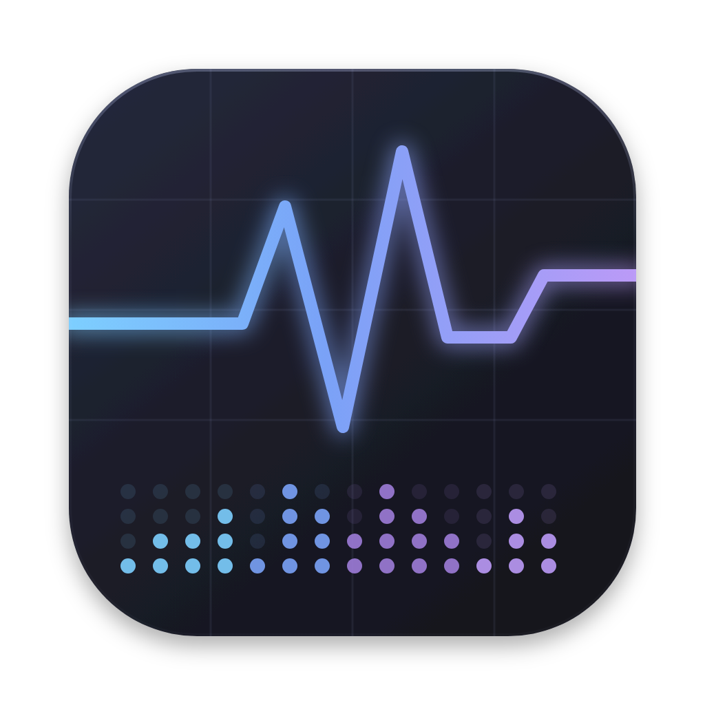
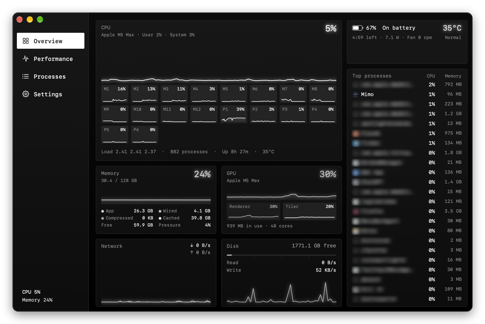
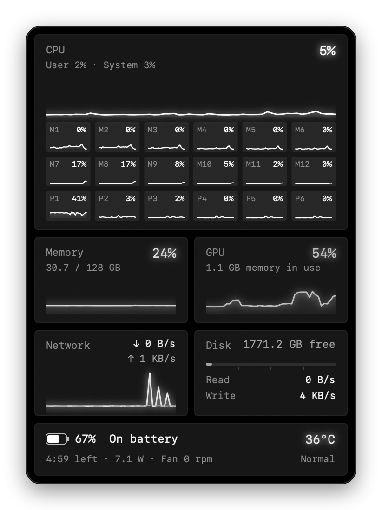

<p align="center">
  
</p>

<h1 align="center">✦ Mimo ✦</h1>

<p align="center">
  A teeny, skinnable system monitor that lives in your menu bar ₍ᐢ. .ᐢ₎♡<br>
  No dependencies · pure Swift · the whole app is about 2MB.
</p>

<p align="center">
  <a href="#-requirements"></a>
  <a href="#-requirements"></a>
  <a href="https://www.swift.org"></a>
  <a href="#-development"></a>
  <a href="https://github.com/lay-kuw/Mimo/releases"></a>
  <a href="LICENSE"></a>
</p>

<p align="center">｡･:*:･ﾟ★ your Mac's heartbeat, right in the menu bar ★ﾟ･:*:･｡</p>

<p align="center">
  
</p>

<p align="center">
  
</p>

---

## 🌸 Contents

- [Features](#-features)
- [Requirements](#-requirements)
- [Install](#-install)
- [How to use](#-how-to-use)
- [Feature details](#-feature-details)
- [Skins](#-skins)
- [Privacy](#-privacy)
- [Good to know](#-good-to-know)
- [Development](#-development)
- [Credits](#-credits)
- [License](#-license)

## ✨ Features

- **💓 Lives in the menu bar**: a little heart that beats faster when your Mac is busy (or a gauge, or mini graphs). Click it and a panel pops out
- **📌 Floating panel**: a tiny panel of live graphs that stays on top of everything. Pick a corner, how see-through it is, and what it shows
- **🪟 Full window**: Overview, Performance, Processes and Settings. Click any card to jump straight to its details
- **🌊 Smooth motion**: graphs glide between samples instead of jumping, even with a 1–2 second update interval
- **🎨 Skins**: 12 built in, from soft Mochi to glowing Monochrome Neon. You can write your own as a JSON file, too
- **🧩 Make it yours**: move, resize and hide the Overview cards, and choose how much detail each one shows
- **🔒 Private**: no network, no accounts, no analytics. Nothing ever leaves your Mac
- **⚡ Light**: about 15 MB of memory and under 1% CPU while it sits in the menu bar

## 🍓 Requirements

- macOS 13 or later
- Apple Silicon or Intel
- To build: Xcode or the Command Line Tools (`xcode-select --install`)

## 🎀 Install

```sh
git clone https://github.com/lay-kuw/Mimo.git
cd Mimo
bash build.sh install
```

This builds the app, runs its self-test, puts it in `~/Applications/Mimo.app`, and launches it. Yay ٩(ˊᗜˋ*)و
To start it at login, add it in System Settings → General → Login Items.

> **Note**
> The bundle identifier is `io.github.lay-kuw.mimo`.

<details>
<summary><b>Sharing it with another Mac</b></summary>

1. Run `bash build.sh dmg`. You get `build/Mimo <version>.dmg`, which works on both Apple Silicon and Intel
2. On the other Mac, open the dmg and drag **Mimo** to **Applications**
3. Mimo isn't notarized by Apple, so macOS blocks the very first launch. Open it once, then go to **System Settings → Privacy & Security** and click **Open Anyway**. You only need to do this once

</details>

## 🐾 How to use

| Action | How |
|---|---|
| Open / close the menu bar panel | Click the menu bar icon |
| Open the window, toggle the floating panel, quit | Right-click the menu bar icon |
| Jump to a card's details | Click the card (in the window or in a panel) |
| Switch screens | `⌘1`–`⌘4` |
| Open Settings | `⌘,` |
| Move between controls | `Tab` / `⇧Tab`, then `Return` or `Space` to press |
| Close the menu bar panel | `Esc`, or click anywhere else |
| Close the window | `⌘W` (Mimo keeps running in the menu bar) |
| Quit | `⌘Q` |

- Closing the window doesn't quit Mimo. It just goes back to living in the menu bar
- Opening the app again doesn't start a second copy
- Everything works with the keyboard and with VoiceOver

## 🍰 Feature details

<details>
<summary><b>📊 What it shows</b></summary>

| Area | Details |
|---|---|
| CPU | Total, user / system, per-core graphs (E / P cores labelled), load average, chip name |
| Memory | Used / total, app / wired / compressed / cached breakdown, swap, memory pressure |
| GPU | Utilisation, renderer / tiler, memory in use, core count |
| Disk | Free space, read / write speed, operations per second, all mounted volumes |
| Network | Download / upload speed, session totals, interfaces and addresses |
| Power | Battery level, time left or time to full, charging watts, power in, system power, cycles, health, adapter |
| Thermal | Thermal state, SoC temperature, hottest sensors |
| Fans | Speed of each fan with its min–max range (only on Macs that have fans) |
| Processes | Grouped by app or per process, sortable, with CPU and memory; quit or force quit |

</details>

<details>
<summary><b>💓 Menu bar icon and panel</b></summary>

- Pick the icon: **Heart** (beats faster under load), **Gauge**, or **Graphs** (tiny live graphs right in the menu bar)
- Choose what it follows: CPU, memory, GPU or network. You can show the value as text next to it, too
- The icon can match the menu bar or take the skin's color
- Clicking it opens a panel. Choose which cards it shows and how detailed they are (Compact / Standard / Detailed)
- Turn the outer frame off and the cards sit right under the menu bar

</details>

<details>
<summary><b>📌 Floating panel</b></summary>

Turn it on in **Settings → Panel**, or right-click the menu bar icon and choose **Floating Panel**.

- It stays above other windows on every Space, even over full-screen apps, and never steals keyboard focus
- Position: top left / top right / bottom left / bottom right of the main display
- Outer frame: on, or off to show only the cards
- Transparency: 0–80%
- Tick what you want to see: CPU, Memory, GPU, Network, Disk, Power and Top processes
- Each card shows the current value over a small live graph, and follows the **Smooth motion** setting
- Clicking a card opens its detail screen in the main window

</details>

<details>
<summary><b>⚙️ Settings</b></summary>

| Page | Options |
|---|---|
| Appearance | Skin, transparency (0–70%) with optional blur, fill under line graphs, custom skins folder |
| Menu Bar | Icon, what it follows, icon color, value text, panel cards, panel detail, outer frame |
| Panel | Floating panel on / off, position, outer frame, transparency (0–80%), which graphs to show |
| Window | Overview layout editor (move, resize, hide, per-card detail), sidebar expanded or icons only |
| General | Update interval (1 / 2 / 5 s), smooth motion, quit |

</details>

## 🎨 Skins

The default is **Monochrome Neon**. There are 12 built in:

Mochi · Mochi Neon · Frosted Glass · Neon · Green Dot · Arcade · Arcade Neon · Night Sakura · Tokyo Night · Tokyo Night Neon · Monochrome · Monochrome Neon

To add your own, open **Settings → Appearance → Open Skins Folder**
(`~/Library/Application Support/Mimo/Skins/`), drop in a `.json` file, and click **Reload Skins**.
Only `id` and `name` are required. Anything you leave out falls back to a default.

<details>
<summary><b>Example skin</b></summary>

```json
{
  "id": "midnight",
  "name": "Midnight",
  "order": 20,
  "appearance": "dark",
  "bgTop": "#14141F",
  "bgBottom": "#0D0D16",
  "surface": "#FFFFFF",
  "surfaceAlpha": 0.06,
  "border": "#2B2B3A",
  "text": "#E6E6F0",
  "textDim": "#8A8AA0",
  "accent": "#7AA2F7",
  "cpu": "#7AA2F7",
  "memory": "#BB9AF7",
  "gpu": "#7DCFFF",
  "network": "#2AC3DE",
  "disk": "#9D7CD8",
  "battery": "#B4F9F8",
  "danger": "#F7768E",
  "font": "system",
  "corner": 12,
  "graph": "line",
  "glow": 6
}
```

</details>

| Key | Values |
|---|---|
| `appearance` | `light`, `dark`, `auto` |
| `font` | `system`, `rounded`, `mono`, `serif`, `pixel` |
| `graph` | `area`, `line`, `bars`, `pixel` |
| `material` | `glass` (frosted window background) |
| `glow` | Glow radius for graphs and values (`0` for none) |
| `scanlines` | `true` for a CRT look |
| colors | `#RRGGBB`, or `label`, `secondaryLabel` or `separator` to follow the system |

See `Resources/Skins/` for complete examples.

## 🔒 Privacy

- **No network**: Mimo makes no network connections at runtime
- **Settings**: stored in the app's preferences (`io.github.lay-kuw.mimo`)
- **Custom skins**: `~/Library/Application Support/Mimo/Skins/`
- **History**: nothing else is written to disk. History is not recorded

To remove everything, quit the app, delete `Mimo.app`, then run:

```sh
defaults delete io.github.lay-kuw.mimo
rm -rf ~/Library/Application\ Support/Mimo
```

## 🌈 Good to know

- 🔺 Temperature uses a private API, so a future macOS update could take it away. The thermal state is still shown
- 🔺 Processes that belong to other users or the system may be missing from the list, or show partial data
- 🔺 The Intel build compiles but hasn't been run on an Intel Mac yet
- 🔺 The app isn't notarized (see [Install](#-install))
- 💭 Graphs in the pixel skins (Green Dot, Arcade, Arcade Neon) step instead of gliding. That's part of the look~

## 🧸 Development

```sh
bash dev.sh
```

Every time you edit something in `Sources/`, it rebuilds and relaunches by itself (`Ctrl+C` to stop).

| Command | What it does |
|---|---|
| `bash build.sh` | Build only (`build/Mimo.app`) |
| `bash build.sh install` | Build, install to `~/Applications` and launch |
| `bash build.sh dmg` | Make `build/Mimo <version>.dmg` for other Macs (Apple Silicon + Intel) |
| `bash dev.sh` | Watch for changes, then rebuild and relaunch |

Every build runs the self-test (counters, disk attach / detach, time axes, quitting, card navigation, keyboard and VoiceOver) and stops if a check fails.

<details>
<summary><b>Command-line flags</b></summary>

| Flag | Purpose |
|---|---|
| `--background` | Start in the menu bar only, without opening the window |
| `--snapshot <dir>` | Render PNGs of every skin, page and panel to `<dir>` and exit |
| `--bench` | Print sampler and drawing timings and exit |
| `--selftest` | Run the built-in checks and exit with a non-zero status if any fail |

</details>

<details>
<summary><b>How it works</b></summary>

Plain Swift and AppKit, compiled with `swiftc`. There's no Xcode project and no third-party dependencies.
Every screen is drawn with Core Graphics in a single view. Smooth graphs and bars are Core Animation layers on top.

| Data | Source |
|---|---|
| CPU, per core | `host_processor_info` |
| Memory | `host_statistics64`, `sysctl` |
| GPU | IORegistry `IOAccelerator` performance statistics |
| Disk I/O | IORegistry `IOBlockStorageDriver` statistics, per disk (attach/detach safe) |
| Network | 64-bit counters from `sysctl` `NET_RT_IFLIST2` (physical `en*` interfaces), addresses from `getifaddrs` |
| Battery, power | IOPowerSources and `AppleSmartBattery` (incl. power telemetry); power-source change notifications |
| Temperature | IOHIDEventSystem thermal sensors (private API, loaded with `dlsym`) |
| Fans | AppleSMC keys `FNum`, `F<n>Ac`, `F<n>Mn`, `F<n>Mx` |
| Processes | `proc_listallpids`, `proc_pid_rusage` |

</details>

```
.
├── Sources/
│   ├── main.swift            Entry point, flags, single-instance check
│   ├── App.swift             Menu bar item, menu bar panel, floating panel, window, menus
│   ├── Store.swift           Settings and skins
│   ├── Sampler.swift         System sampling (CPU, memory, GPU, disk, network, power, thermal)
│   ├── Fans.swift            SMC fan reader
│   ├── Processes.swift       Process list
│   ├── DashboardView.swift   Main view: tabs, panels, processes, settings
│   ├── Widgets.swift         Overview / panel cards
│   ├── Performance.swift     Performance pages
│   ├── Layout.swift          Overview grid, layout editor, sidebar, menu bar settings
│   ├── SmoothOverlay.swift   Core Animation graphs and bars
│   ├── MenuBarIcons.swift    Animated menu bar icons
│   ├── Theme.swift           Skin model, fonts, graph drawing
│   ├── Format.swift          Byte, rate and rpm formatting
│   ├── Logic.swift           Counter deltas, time binning, power source, quit decisions
│   ├── SelfTest.swift        --selftest
│   └── Snapshot.swift        --snapshot and --bench
├── Resources/
│   ├── AppIcon.png           App icon (1024×1024)
│   ├── Skins/                Built-in skins (JSON)
│   └── Fonts/                Pixel font for the pixel skins
├── Info.plist
├── build.sh                  Build / install / dmg
├── dev.sh                    Watch for changes and rebuild
└── LICENSE                   MIT License
```

## 💝 Credits

- Pixel skins use [DotGothic16](https://fonts.google.com/specimen/DotGothic16) by Fontworks, under the SIL Open Font License (`Resources/Fonts/DotGothic16-OFL.txt`). The bundled copy is subset to Latin, symbols and kana to keep the app small. Other characters fall back to the system font

## 💌 License

[MIT License](LICENSE). Anyone can use it freely (modify it, share it, even use it commercially). Enjoy ❤️
